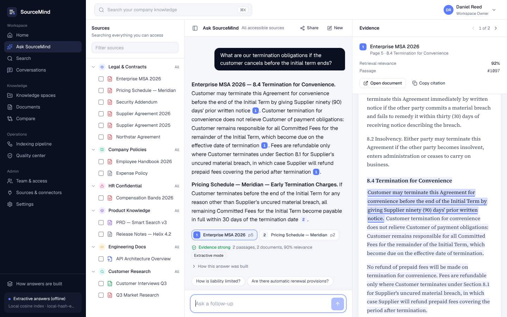

# SourceMind AI

**Ask your company knowledge. Verify every answer.**

SourceMind is an enterprise knowledge workspace built on retrieval-augmented generation (RAG). Teams upload documents into permissioned knowledge spaces, search them by meaning, ask questions across many sources, and verify every answer against the exact passage it came from.



It is a complete, working product — not a mock-up. Every number on screen comes from the running system: documents are parsed, chunked, embedded and indexed by a real pipeline; answers are retrieved with hybrid search and checked for grounding; quality metrics come from real evaluation runs.

---

## Quick start

Requirements: **Node.js 20.10+** (22 recommended). Nothing else — no database, no API key.

```bash
npm install        # installs root, server and client
npm run dev        # API on :4000, web app on :5173
```

Open **http://localhost:5173**. On first start the server builds a demo workspace (14 documents, 6 spaces, 5 users) by running the real ingestion pipeline — this takes about 20 seconds.

Production build, served from one port:

```bash
npm run build
npm start          # http://localhost:4000
```

Reset the demo workspace at any time (stop the server first):

```bash
npm run seed
```

### Demo accounts

All passwords are `demo1234`. The sign-in page offers one-click access to each.

| Person | Role | Teams | What they can retrieve from |
|---|---|---|---|
| Daniel Reed | Workspace Owner | management | Everything |
| Olivia Brooks | Admin | hr, management | Everything |
| Sarah Chen | Knowledge Manager | legal | Legal & Contracts, Company Policies |
| Marcus Hale | Member | engineering, product | Policies, Product, Engineering, Research |
| Priya Nair | Viewer | sales | Read-only: documents and shared answers |

**Try this:** sign in as Marcus and ask *"What is the salary band for an L5 Staff Engineer?"* — SourceMind declines, because the compensation document sits in a space only HR can access. Sign in as Olivia and ask the same question: you get the answer with a citation.

---

## Modes

SourceMind runs at three levels without code changes. Set variables in `server/.env` (see `server/.env.example`).

| | Offline (default) | + LLM | Full stack |
|---|---|---|---|
| Answers | Extractive: cited sentences selected from the top passages | Generated by any OpenAI-compatible model, then citation-validated | Same |
| Embeddings | `local-hash-embed-v1` (synonym-aware feature hashing) | `text-embedding-3-small` or any OpenAI-compatible model | Same |
| Vectors | In-process cosine index | Same | **Qdrant** |
| App data | Embedded JSON store | Same | **MongoDB** |
| Set | nothing | `OPENAI_API_KEY` (+ `OPENAI_BASE_URL`, `CHAT_MODEL`, `EMBEDDING_MODEL`) | `QDRANT_URL`, `MONGODB_URI` |

Switching embedding model is safe: on boot the server notices the model changed and re-embeds every passage.

Full stack with Docker:

```bash
echo "OPENAI_API_KEY=sk-..." > .env    # optional
docker compose up --build              # app + Qdrant + MongoDB on http://localhost:4000
```

---

## What's in the product

| Screen | What it does |
|---|---|
| **Home** | Ask box with suggested questions, workspace metrics, knowledge spaces, recent questions and uploads |
| **Ask SourceMind** | Three-panel workspace: pick sources → streamed answer with numbered citations → evidence panel showing the passage highlighted on its page. Evidence strength, follow-ups, safe "I don't know", and a trace of how each answer was built |
| **Evidence viewer** | Full page view of a cited passage with relevance, passage id, previous/next passage, surrounding context, copy citation and original download |
| **Search** | Hybrid, semantic-only or keyword-only search with facets (space, type, owner, tags, date) and per-result score breakdown |
| **Compare** | Extracts commercial and legal terms from two documents (payment terms, late fees, liability cap, notice, SLA, retention…), flags differences, cites every value, compares any clause side by side, exports a Markdown report |
| **Documents** | Library with live ingestion status, access level, owner, re-index and delete |
| **Document detail** | Executive summary, key terms linked to their source, topics, suggested questions, a reader, every passage, and the processing log |
| **Indexing pipeline** | Upload → Parse → OCR → Chunk → Embed → Index → Summarise, with timings, events, queue and a sample passage |
| **Quality center** | Runs a labelled evaluation set; groundedness, citation coverage, retrieval hit rate, precision@5, answer relevance, no-answer accuracy; trend and retrieval-strategy comparison; per-question results |
| **Knowledge spaces** | Isolated collections with team-based access rules |
| **Team & access** | Roles, team membership, permission matrix and audit log |
| **Settings** | Retrieval strategy, semantic weight, reranking, query rewrite, candidate pool, top-k, minimum relevance, chunk size/overlap, LLM on/off |
| **How answers are built** | The live architecture of this workspace |

---

## How it works

### Ingestion

1. **Parse** — PDF via pdf.js (page-accurate, font-size heading detection), DOCX via mammoth, Markdown/TXT, CSV (each row a record), web pages fetched server-side.
2. **Clean** — running headers, footers and page numbers are removed; image-only pages are detected (see OCR below).
3. **Chunk** — section-aware: pages are cut at headings so a passage never spans two sections, then split with LangChain's `RecursiveCharacterTextSplitter` (default 220 tokens, 30 overlap). Each chunk keeps exact character offsets into its page, which is what makes precise highlighting possible.
4. **Embed** — each passage is embedded together with its document title and section heading.
5. **Index** — vectors go to the vector store, text to a BM25 inverted index.
6. **Summarise** — executive summary, key terms (with the passage each came from), topics and suggested questions.

Jobs run through an in-process queue (concurrency 2), report per-stage status and timing, and resume after a restart.

### Answering

```
question
  → permission filter        documents this person can open (before any search)
  → query rewrite            strip question words, add domain synonyms for the keyword leg
  → hybrid retrieval         vector cosine + BM25 in parallel, both filtered by permission
  → reciprocal rank fusion   weighted by the semantic weight setting
  → rerank                   concept coverage, semantic similarity, keyword score, heading match
  → relevance gate           below the threshold, or a specific identifier (e.g. "L5") missing → decline
  → generate                 LLM over numbered passages, or extractive selection
  → citation validation      drop citations to passages that were not provided, score support per sentence
  → evidence strength        from the number, spread and relevance of the cited passages
```

**Permission-aware retrieval.** Access is resolved from the user's role and teams and each space's rules, then pushed into the vector query (a Qdrant `match any` filter or the local index filter) and the BM25 scorer. Restricted passages are never scored, ranked or sent to a model. Conversations shared later are re-filtered for the viewer.

**Evidence strength, not "AI confidence".** The badge under each answer reports how many passages and documents support it and their retrieval relevance — something the system can actually measure.

### Evaluation

The Quality center runs every labelled question through the full answer pipeline:

| Metric | Definition |
|---|---|
| Groundedness | Share of answer content (by tokens) supported by the passages each sentence cites |
| Citation coverage | Share of answer sentences that carry a valid citation |
| Retrieval hit rate | Expected document *and page* appear in the top 5 passages |
| Retrieval precision@5 | Share of the top 5 passages that come from the expected document |
| Answer relevance | Share of the question's concepts addressed by the answer |
| No-answer accuracy | Unanswerable questions correctly declined |

The demo seeds 22 questions (including paraphrased ones and three with no answer) and four real runs comparing keyword-only, vector-only, hybrid and hybrid + rerank retrieval. In offline mode answers are extractive, so groundedness is high by construction; connect an LLM to measure generation quality.

---

## Project structure

```
sourcemind/
├── client/                    React 19 + TypeScript + Vite + Tailwind + TanStack Query
│   └── src/
│       ├── components/        Shell, UI kit, evidence/page viewer, pipeline steps, upload dialog
│       ├── lib/               API client (incl. SSE streaming), auth context, types, formatting
│       └── pages/             one file per screen
├── server/                    Node.js + Express 5 + TypeScript
│   └── src/
│       ├── auth/              JWT auth, roles → capabilities, permission boundary
│       ├── rag/               parsers, chunker, embeddings, vector stores, BM25, retriever,
│       │                      answer generation, grounding, extractors, compare, evaluation,
│       │                      summaries, ingestion pipeline, LLM client
│       ├── routes/            REST API
│       ├── seed/              demo workspace content (PDF/DOCX/MD/TXT/CSV generated at seed time)
│       └── store/             collection layer with JSON or MongoDB persistence
├── docs/screenshots/          product screenshots + Upwork cover
├── Dockerfile
└── docker-compose.yml         app + Qdrant + MongoDB
```

### API overview

All routes are under `/api` and require `Authorization: Bearer <token>` except login.

| Method | Route | Purpose |
|---|---|---|
| POST | `/auth/login` | Sign in, returns JWT |
| GET | `/dashboard` | Home metrics, spaces, activity |
| GET/POST/PATCH/DELETE | `/spaces` | Knowledge spaces and access rules |
| GET | `/documents` | Library (permission-filtered) |
| POST | `/documents/upload` · `/documents/url` | Ingest files or a web page |
| GET | `/documents/:id` · `/pages` · `/chunks` · `/file` | Detail, page text, passages, original |
| POST | `/documents/:id/reprocess` | Re-index |
| GET | `/chunks/:id` | Evidence: passage, page, neighbours |
| POST | `/search` | Hybrid / vector / keyword search with filters |
| POST | `/chat/ask` | Answer a question (server-sent events stream) |
| GET/PATCH/DELETE | `/conversations` | History and sharing |
| POST | `/compare` · `/compare/clause` | Document and clause comparison |
| GET | `/pipeline` | Ingestion status and queue |
| GET/POST | `/quality` · `/quality/run` · `/quality/cases` | Evaluation |
| GET/POST/PATCH/DELETE | `/team` | Members and roles |
| GET/PATCH | `/settings` | Retrieval configuration |
| GET | `/audit` | Audit log |

---

## Notes and limits

- **OCR** is detected, not performed: image-only PDF pages are reported in the pipeline and skipped, and fully scanned PDFs fail with a clear message. Plug an OCR engine (e.g. Tesseract or a cloud OCR API) into the `ocr` stage in `server/src/rag/pipeline.ts`.
- **Connectors** for Google Drive, Notion, Confluence, Dropbox and SharePoint are shown as *Planned* — they are not implemented. PDF, DOCX, TXT, Markdown, CSV and web pages are.
- The **offline embedder** is a deterministic, synonym-aware hashing model. It works well on the demo but is not a neural embedding; set `OPENAI_API_KEY` for production-quality semantic search.
- The local vector index is exact (brute force) and suited to tens of thousands of passages; use Qdrant beyond that.
- The MongoDB and Qdrant adapters follow those services' standard APIs; the default embedded mode is what the demo runs on.
- The demo data and companies (Helix Systems, Meridian Retail, Kestrel Cloud) are fictional.
